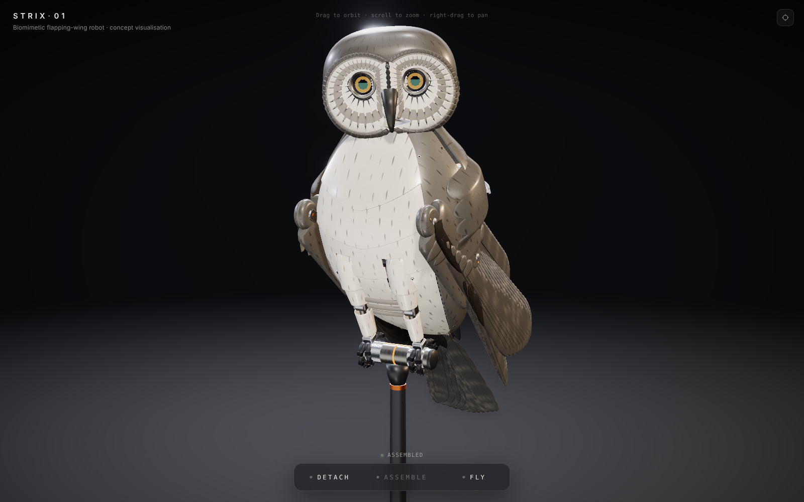
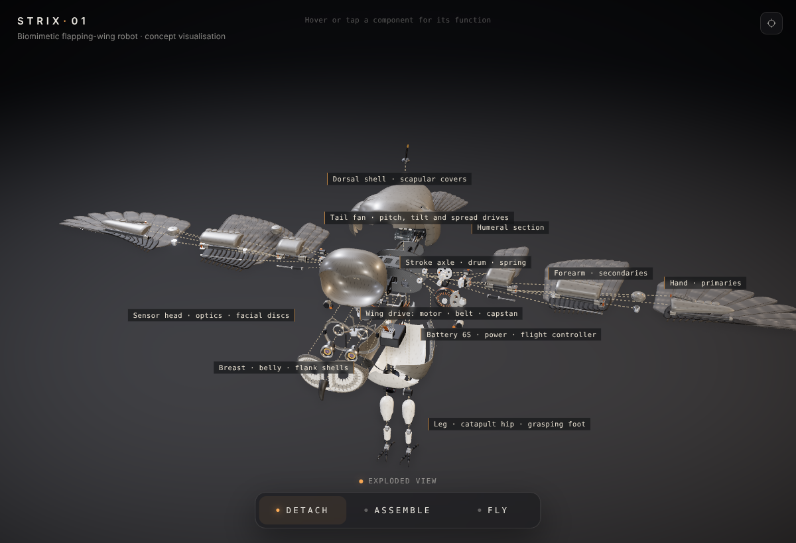
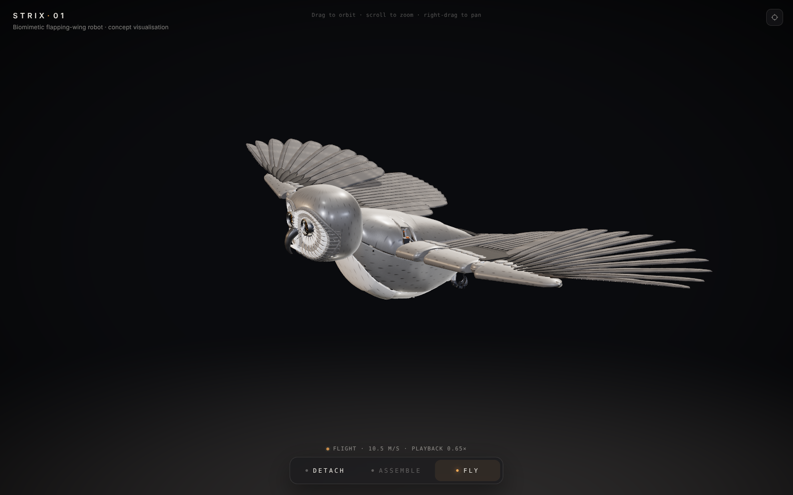

# STRIX-01 — owl-form flapping-wing robot

An interactive 3D concept visualisation of an electrically powered, owl-shaped ornithopter. You can orbit it on
its stand, explode it into an engineering view with labelled sub-assemblies, reassemble it exactly, and fly it
around a racetrack course with a simulated wingbeat.

Built with **React + TypeScript + Three.js + React Three Fiber + Drei + GSAP** (Vite). The geometry is a
**Blender-generated GLB**: every part is modelled by a Python script and exported with a named, hierarchical
node tree. Nothing on screen is an image or video. The engineering concept behind the model is written up in
[`ENGINEERING.md`](ENGINEERING.md). It is a concept, not a validated design (see
[What is not validated](#what-is-not-validated)).

| Perched | Exploded view | Flight |
|---|---|---|
|  |  |  |

## Quick start

Requirements: **Node 18+** (built and tested with Node 22). Rebuilding the 3D model also needs **Python 3.13**
with **Blender 5.x as a Python module** (`pip install bpy`; built with bpy 5.2). The built models are included,
so the model step is optional. The tests need Python with **Playwright** and its Chromium.

```bash
npm install          # dependencies
npm run dev          # dev server on http://localhost:5173
npm run build        # type-check (tsc) + production build into dist/
npm run preview      # serve dist/ locally
npm test             # functional browser tests against a running server (see Testing)
npm run model        # optional: rebuild the GLBs from the Blender scripts (~40 s)
npm run build:hosted # optional: build for restricted hosts into dist-hosted/ (see below)
```

`dist/` is a static site; it can be served from any static host. The GLB (≈ 4.7 MB, meshopt-compressed) is
loaded from `dist/assets/`.

`build:hosted` is for hosts with restrictions, such as the published claude.ai page. It adds two
fallbacks in `src/owl/model.ts`. If the page's content-security policy refuses WebAssembly (which meshopt
decoding needs), it loads an uncompressed copy with lighter tessellation (`strix-plain.glb`, ≈ 9 MB). Both
GLBs are also wrapped as base64 JSON, for hosts that only serve standard web file types.

### Controls

| Input | Action |
|---|---|
| **DETACH** / `D` | Staged exploded view (works from ASSEMBLED or mid-assembly) |
| **ASSEMBLE** / `A` | Reassemble onto the stand (works from DETACHED or mid-detach) |
| **FLY** / `F` | Take off, fly the course, land back on the stand. From the exploded view it assembles first |
| Left drag · wheel · right drag | Orbit · zoom · pan |
| Reset button (top right) / `R` | Animated return to the default front three-quarter view |
| Hover / click a part | Part name and function (assembled or exploded) |

During a flight, DETACH is queued: the robot turns back, lands, then explodes.

URL options: `?low` (no shadows or AO, lower DPR), `?nopost` (no post-processing), `?hq` (fixed high quality),
`?capture` (render on demand; used by the screenshot tools). On a slow device the app also steps quality down by
itself (drei `PerformanceMonitor`).

## Project layout

```
blender/            model generator (Blender Python, headless)
  build_owl.py        assembles all parts, hierarchy, mass budget, normal audit, GLB export, build_report.json
  parts_body.py       frame, battery, avionics, shells, scapular covers
  parts_head.py       head frame, facial discs, optics (iris/lids), beak, neck gimbal
  parts_wing.py       root drive (motor, belt, capstan, sector drum, spring), spars, fairings, feathers
  parts_tail_legs.py  tail actuator and fan, legs, zygodactyl feet, display stand
  lib.py              mesh helpers (lathes, sweeps, panels, feathers, fasteners)
src/
  owl/model.ts        GLB loading (meshopt; optional no-WebAssembly and JSON-wrapped fallbacks)
  owl/RobotOwl.tsx    swaps materials, instances fasteners, wires rig/assembly/director
  owl/rig.ts          kinematic rig: Pose -> joint rotations
  owl/director.ts     state machine, idle behaviour (head/eye tracking, blinks), perch balance, flight hand-off
  owl/flight.ts       wingbeat generator, flight path and flight simulation
  owl/assembly.ts     exploded-view controller (staged, interruptible, exact restore)
  owl/parts.ts        part descriptions, explode timings, exploded-view layout
  owl/materials.ts    PBR materials (titanium, graphite, ceramic, carbon, amber) with procedural textures
  owl/Labels.tsx, Leaders.tsx   exploded-view callouts and leader lines
  scene/Studio.tsx    studio lighting, environment, floor, shadows
  scene/CameraRig.tsx orbit / framing / flight-tracking camera
  scene/DebugBridge.tsx  window.__owl automation hooks (tests and screenshots)
  ui/Overlay.tsx      header, controls dock, info card, loader
tests/functional.py   browser functional tests (Playwright)
tools/shoot.py        fixed-view screenshot capture (critic loop)
tools/embed-glb.mjs   wraps GLBs as base64 JSON for build:hosted
ENGINEERING.md        engineering concept, assumptions and estimates
```

## How the model is built

`npm run model` runs `blender/build_owl.py` headless. Each part is generated from code (lathes, lofted
super-elliptic sections, swept spars, feathers built from rachis + vane, panel shells cut from a body
surface) and placed in the assembly hierarchy, then:

* **naming**: `A_*` explodable assemblies, `P_*` parts, `J_*` joints (animated, never exploded), `K_*`
  kinematic sub-meshes (iris blades), `FAST_*` fastener placements (instanced at runtime), `G_grip_*` grip
  references;
* **left/right** parts are built once and mirrored, so the right wing is an exact mirror image;
* **normal audit**: closed mesh islands with negative signed volume are flipped (219 in the current build);
* **mass budget**: each part has a budget mass; the build reports total mass, centre of mass, planform area,
  span, wing loading, and the stroke inertia of the moving wing (`blender/build_report.json`), which feed
  `ENGINEERING.md` and the app (perch balance uses the computed centre of mass);
* the GLB is compressed with **gltfpack** (meshopt), keeping node names, materials and float UVs; a second,
  uncompressed copy simplified to 60 % is written for the no-WebAssembly fallback.

≈ 300 objects, ≈ 670 k triangles. Materials are assigned by name in the app as `MeshPhysicalMaterial`s with
procedural canvas textures (brushed titanium, graphite, satin ceramic with pad-printed owl barring, carbon
weave, amber accents) so the GLB stays small.

## Component hierarchy

```
OWL
├─ A_core: P_frame (keel + girdle), P_battery, P_fc, P_vision (+IMU), P_pdu,
│          P_shell_front, P_shell_rear, P_flank_L/R, P_ventral, J_scapular_L/R → P_scapular_L/R,
│          P_sensorPod (ventral surveillance turret), P_antenna (comms downlink)
├─ A_head: P_neck, J_neckPitch → P_neckCradle, J_neckYaw → A_headUnit
│    └─ P_headFrame, P_crown, P_face_L/R, P_beak, J_eye_L/R → P_optic_L/R (iris blades K_iris_*, lids J_lid*)
├─ A_wing_L/R: P_rootMotor, P_capstan, J_shoulder → P_shoulderHub, P_sectorDrum, P_torsionSpring, P_pitchServo
│    └─ J_sweep → J_armPitch → A_arm: P_humerus, P_humFairing, P_foldActuator, P_membrane, P_elbowCover, P_ter_01..03
│         └─ J_elbow → A_forearm: P_sparPrimary, P_leFairing, P_carpalCover, J_foldRod → P_foldRod,
│              A_secondaries (P_sec_01..11)
│              └─ J_wrist → P_wristJoint, J_handTwist → A_hand: P_sparSecondary, P_handFairing,
│                   J_alula → P_alula, A_primaries (P_pri_01..10)
├─ A_tail: P_tailMount, J_tailPitch → J_tailTilt → P_tailActuator (+ tail coverts), A_tailFan (P_rect_01..12)
└─ A_landing: A_leg_L/R: P_hipMount, J_hip → P_legUpper, J_ankle → P_tarsus, P_foot (J_toe_* chains, G_grip)
```

The fuselage, head, tail and legs carry a 1.18 node scale relative to the wing structure (owl proportions);
the sweep joints carry the inverse, so the wings keep their size.

## Runtime architecture

### State machine (`director.ts`)

States: `ASSEMBLED`, `DETACHING`, `DETACHED`, `ASSEMBLING`, `TAKING_OFF`, `FLYING`, `LANDING`.

| Command | From | Result |
|---|---|---|
| DETACH | ASSEMBLED, ASSEMBLING | DETACHING → DETACHED (reverses an assembly in progress from where it is) |
| DETACH | TAKING_OFF, FLYING, LANDING | queued; the flight is re-routed home, lands, then detaches |
| ASSEMBLE | DETACHED, DETACHING | ASSEMBLING → ASSEMBLED (reverses a detach in progress); cancels a queued DETACH |
| FLY | ASSEMBLED | TAKING_OFF → FLYING → LANDING → ASSEMBLED |
| FLY | DETACHED, DETACHING, ASSEMBLING | queued; assembles first, then takes off |
| anything else | — | ignored (the buttons are also disabled) |

All animation runs on the Director's own clock (`gsap.updateRoot(clock)`), so timelines, the flight and the
idle behaviour are deterministic and can be stepped without rendering, which is how the tests run.

### Exploded view (`assembly.ts`, `parts.ts`)

Every explodable node stores its canonical transform from the GLB. Its exploded state is a single progress
value p ∈ [0, 1] split into phases: fasteners back out (instanced screws spin and rise), the part releases
along a short local vector, then travels to its exploded position. Detach and assemble are GSAP timelines
over these progress values with per-part delays (outer parts first on detach, inner parts first on assembly),
so an interrupt simply starts a new timeline from the current values. **At p = 0 a part's transform is copied
back from its stored canonical value**, and the rig only writes `joint = canonical · rotation`, so assembly
is exact and cannot drift (verified below).

Exploded positions are not hand-placed: `computeLayout()` measures the real bounding boxes and stacks
sub-assemblies along principal axes with uniform gaps (core up/down, wings outward along the span, head
forward, tail aft, legs down). Callouts with leader lines name each sub-assembly once the explosion settles.

### Rig and wing animation (`rig.ts`, `flight.ts`)

A `Pose` holds per-wing `stroke`, `sweep`, `pitch`, `handTwist`, `fold`, `alula`, `featherOpen`, `fan` and
`bend`, plus neck, eyes, lids, iris, tail and legs. `OwlRig.apply(pose)` writes them to the joints:

* **stroke** about the body's longitudinal axis at the shoulder (`J_shoulder`), **sweep** about the wing
  normal (`J_sweep`), **arm pitch** about the humeral spar (`J_armPitch`);
* **fold**: elbow and wrist flex together (a parallel-rod Z-fold, `J_elbow` / `J_wrist`, with the visible fold
  rod sliding); secondaries rotate to lie along the hand as it folds; scapular covers drop over the wing root
  when fully folded;
* **hand twist** = arm pitch × gain (slaved by a tendon in the concept);
* **feathers**: primaries and secondaries pronate (close) on the downstroke and open on the upstroke through
  `R_*` wrapper groups inserted at load, so feather articulation never conflicts with the exploded view;
  primaries also fan and bend.

`wingbeat(phase, amplitude, …)` generates one stroke cycle: a 56 % downstroke / 44 % upstroke split, stroke
angle as a split cosine, arm pitch nose-down in the downstroke and nose-up in the upstroke, **active upstroke
flex** (≈ 0.3 of full fold at mid-upstroke), feather opening on the upstroke and a small sweep oscillation.
The flight simulation drives it with smoothly varying frequency and amplitude (take-off 4.3 Hz / ±52°,
cruise 3.8 Hz / ±36°, landing 4.2 Hz / ±46°, zero amplitude in the glide) and uses stroke-amplitude asymmetry
for roll.

### Flight (`flight.ts`, `director.ts`)

FLY unfolds the wings on the stand, crouches, launches with a short dip and climbs out towards the viewer,
then flies a racetrack course (two 18 m-radius turns at ≈ 32° bank joined by a 26 m straight), glides on the
return leg, and finishes with a flapping approach from behind the stand, a flare with the tail spread, and a
landing on the stand. Speed, bank (from path curvature, capped at 34°), body pitch
(climb + angle of attack + flare) and head stabilisation are computed per frame; the last half metre blends
into the feet-locked perch transform so the landing is seamless. The camera switches to a damped chase that
keeps the user's orbit offset. Flight plays back at 0.65× real time to make the wingbeat readable.

## Mechanical assumptions (summary)

Full details, estimates and sources of each figure are in [`ENGINEERING.md`](ENGINEERING.md).

* 2.33 kg budget mass (computed from per-part budgets in the model, including a 53 g surveillance payload —
  the ventral EO/IR turret and comms antenna), 1.44 m span, 0.37 m², aspect ratio 5.6,
  wing loading 60–70 N/m²; cruise 10.5 m/s at mean C_L ≈ 0.9; 30 % growth margin carried.
* Each wing is driven independently by a 58 mm pancake motor through a 3 : 1 belt and a 4.6 : 1 Dyneema
  capstan stage to a sector drum on the stroke axle, with an **elastomer torsion spring** tuned to resonance
  (≈ 12 N·m/rad), a latching clutch and a fail-safe stroke brake / glide lock.
* Arm pitch by a high-speed servo; hand twist slaved by tendons; elbow and wrist fold by one ball-screw actuator
  with a parallel rod; feather pitch and alula passive; sweep by a worm-geared servo (stow and trim).
* Two-axis tail (pitch is the fast pitch-stability effector; tilt and spread), statically unstable pitch by
  design, active yaw control.
* 6S 1300 mAh LiPo, ≈ 130 W in cruise, ≈ 9–11 min endurance; catapult hip springs for launch; zygodactyl
  feet with a ratcheting tendon grip.

## What is not validated

Everything in the engineering model is an estimate. In particular: whether the wing can produce the required
mean and peak lift at this wing loading (quasi-steady estimate; unsteady effects at reduced frequency ≈ 0.28
are not modelled); the spanwise pitch schedule and passive feather behaviour; drive thermal balance and
voltage margin in the flare; structural, bearing, belt and cable sizing and life; the elastomer spring's
hysteresis, heating and fatigue; clutch and brake dynamics; endurance; pitch and yaw control laws; the launch
(it needs a 4–5 m perch or a launcher — **the demo's 1.35 m stand and short dip are a visual
simplification**) and the perching landing; landing loads; noise; and the mass budget itself — nothing has
been weighed. The flight in the app is a kinematic animation along a scripted path, not an aerodynamic
simulation.

## Testing

### Functional tests

`python3 tests/functional.py [URL]` (Playwright + headless Chromium) drives the real UI — buttons, keyboard
shortcuts, mouse drag/wheel/right-drag, hover and click — and steps simulated time through the same
`Director.update()` code a rendered frame runs. Results go to `tests/results.json`.

Final run against the production build (`npm run build`, served statically), headless Chromium with the
SwiftShader software renderer: **15 of 16 passed**.

| # | Check | Result | Measured |
|---|---|---|---|
| 1 | Page loads, GLB hierarchy present, no console errors | pass | 129 parts, 54 joints, 0 errors |
| 2 | Starts ASSEMBLED with the right buttons enabled | pass | ASSEMBLE disabled, DETACH and FLY enabled |
| 3 | Mouse orbit, wheel zoom, right-drag pan, reset button | pass | reset returns to the default view within 0.1 mm |
| 4 | DETACH: staged explode with labelled callouts | pass | 4.85 s; parts travel up to 0.36 m; 11 callouts |
| 5 | ASSEMBLE restores exactly | pass | 247 nodes vs load: ≤ 5×10⁻¹⁶ m, ≤ 4×10⁻⁸ rad |
| 6 | Six DETACH/ASSEMBLE cycles: no drift | pass | same error bound after every cycle |
| 7 | Interrupts: ASSEMBLE mid-detach, DETACH mid-assembly | pass | interrupted at 50 % and 24 %; exact restore |
| 8 | FLY: take-off, flight, landing on the stand | pass | 29.6 s simulated; no position jumps; perch error 0.00 mm |
| 9 | Wingbeat kinematics | pass | ±35.9° at 3.80 Hz; L/R identical when wings level; upstroke fold 0.32 vs 0.03 downstroke; arm pitch +5.1° down / −3.3° up |
| 10 | Banked turns within limit, glide, return | pass | max bank 32.8° (limit 34°) |
| 11 | FLY while detached assembles first | pass | explode progress 0 at take-off |
| 12 | Second flight restores exactly | pass | node error 5×10⁻¹⁶ m |
| 13 | 120 random key presses in every state; DETACH during flight | pass | always settles; DETACH is queued, lands, then explodes; 0 errors |
| 14 | Hover/click part info; head follows the pointer | pass | info card shows and pins; neck yaw +16° vs +41° |
| 15 | Performance | **fail** | 1,632 draw calls per frame at full quality (my own target was < 1,500); 842 in low quality; simulation 0.05 ms per update |
| 16 | Reload at phone size (390 × 844) | pass | clean start, controls on screen, no horizontal overflow |

The performance check failed only on my own draw-call budget: shadow, AO and post-processing passes redraw
≈ 800 primitives. The software renderer manages 0.4 fps at full quality and 1.3 fps at low quality, which
says nothing about a GPU. Frame rate on real hardware was not measured. The published page's fallback
loader was also checked separately: under a strict content-security policy that refuses WebAssembly it loads
the uncompressed model, and DETACH, ASSEMBLE and FLY complete with exact restoration.

### Independent critique loop

Fixed-view screenshots (front three-quarter, side, rear, exploded, mid-flight with wings extended, mid-flight
with wings partially folded) were sent to an independent visual critic, and `ENGINEERING.md` to a separate
engineering critic. Neither saw the source code, earlier critiques or a target score. Six rounds were run; the
fixes after each round are reflected in the current model and documents.

| Round | Visual realism | Engineering credibility |
|---|---|---|
| 1 | 5 / 10 | 5 / 10 |
| 2 | 5 / 10 | 6 / 10 |
| 3 | 5.5 / 10 | 6 / 10 |
| 4 | 5 / 10 | 6 / 10 |
| 5 | 5 / 10 | 6 / 10 |
| 6 | 5 / 10 | 6 / 10 |

**The 9/10 target was not reached on either axis.** The loop was stopped after round 6 because the scores had
plateaued while the remaining criticisms moved to things this project cannot resolve by iteration: the visual
critic judged it against offline-rendered, hand-sculpted feather and surface detail (feathers read as rigid
plates, materials as CG, some proportions robotic rather than owl-like), and the engineering critic's
remaining points require test data — measured unsteady lift, spring and cable life, real component masses.
The concrete issues from round 6 (spring concept, launch height, pitch and yaw effectors, glide lock, turn
limits, mass bookkeeping, actuator sizing, growth margin) were corrected in `ENGINEERING.md` afterwards but not
re-scored.

## Known limitations

* Visual: feathers are rigid panels with procedural barring, not groomed or simulated; the perched wing stow,
  feet and some joint covers read as mechanical; the exploded view of the dense core is busy.
* The app was tested only in headless Chromium with a software renderer (SwiftShader). Frame rates measured
  there (below 1 fps at full quality) say nothing about a real GPU; real-device performance, and Safari and
  Firefox, were not tested.
* The flight is scripted kinematics on a fixed course.
